<p align="center">
  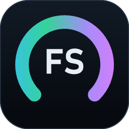
</p>

<h1 align="center">FS HW Monitor</h1>

<p align="center">
  A full-screen temperature dashboard for the little display inside your PC case.<br>
  CPU · GPU · RAM · SSD · Cooling, with live gauges and session high / average / low.
</p>


## Features

- **Made for in-case screens, any shape.** It finds the panel on its own and covers it pixel-for-pixel, whatever your Windows scaling is. The layout follows the screen's shape:

  | Screen | Layout |
  | --- | --- |
  | 1280×800, 1024×600, 16:9 | Landscape: tall cards side by side |
  | 800×1280 (mounted vertically) | Portrait: the cards stacked as rows |
  | 1920×480, 2560×720 strips | Wide strip: compact cards in a row |
  | 480×1920 | Tall strip: compact cards in a column |
  | Square-ish | Grid: two columns |

- **Segmented neon gauges.** The ring shifts from the card's color to amber to red as a part nears its limits, and small markers show the session low and high.
- **High / avg / low for each part,** plus a history graph (1 to 60 minutes) and a range readout.
- **Five cards:** pick which ones show and in what order.
  - **CPU:** Tctl/Tdie (or package temp on Intel), CCD temps, load, power, clock
  - **GPU:** core, hot spot, VRAM, load, power, fan. The discrete card is picked over the iGPU.
  - **RAM:** the temperature sensor on every DDR5 stick (and DDR4 sticks that have one), plus memory used
  - **SSD:** NVMe/SATA temp, life left, space used, read and write speed
  - **Cooling:** liquid temperature from an AIO, plus up to five fans or pumps with names you choose
- **Most used:** each card names the app using that part the most. Hover it for the top five, with icons:
  - **CPU:** share of total CPU time
  - **GPU:** busiest GPU engine (Task Manager's GPU column)
  - **RAM:** private memory
  - **SSD:** file reads and writes per second

  Apps with many processes, like Chrome, count as one.
- **Pick the sensor behind any gauge,** for example GPU hot spot instead of core, or a specific drive.
- **Six built-in themes, plus your own** from a small JSON file. The default, **Full Send**, matches [fullsendwow.com](https://fullsendwow.com): flat charcoal cards, the blue/red FS mark, and Poppins and PT Sans type.
- **Night mode:** dims or blacks out the dashboard on a schedule, and lights back up if anything runs hot.
- **Settings window, °C / °F, always on top, close to tray,** and **Start with Windows** (starts elevated at sign-in with no UAC prompt).
- **A normal installer, or one portable `.exe`.** Either way, no .NET install needed.

### Themes

| Full Send (default) | Neon | Carbon |
| --- | --- | --- |
| 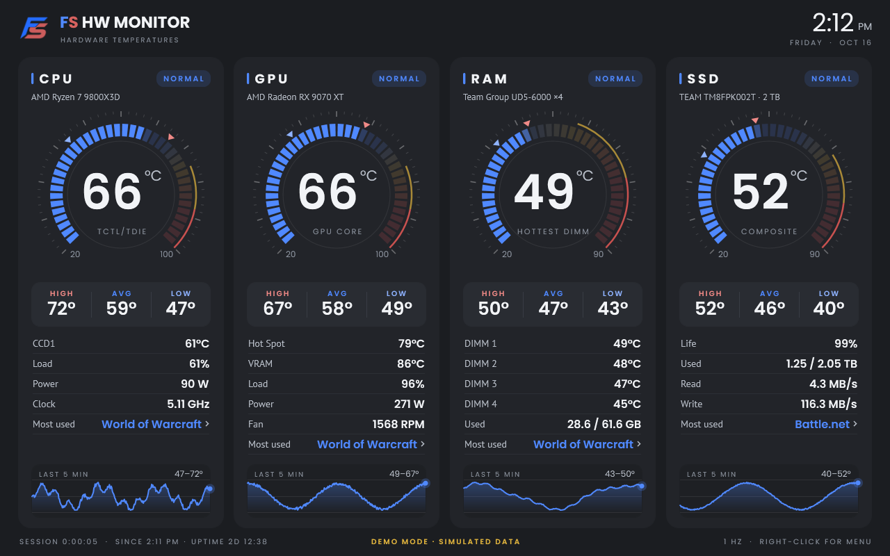 | 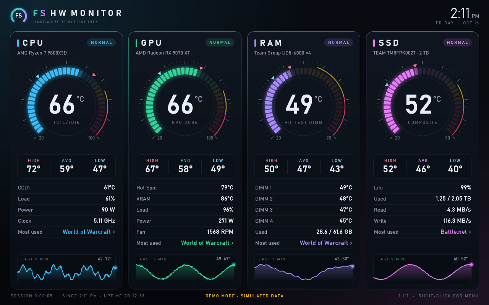 | 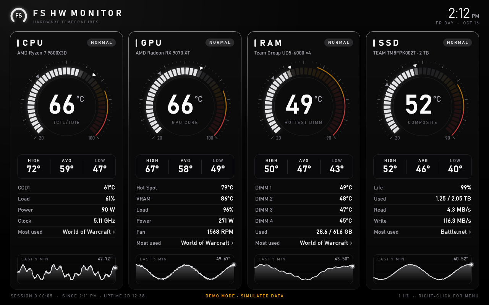 |

| Synthwave | Frost | Terminal |
| --- | --- | --- |
| 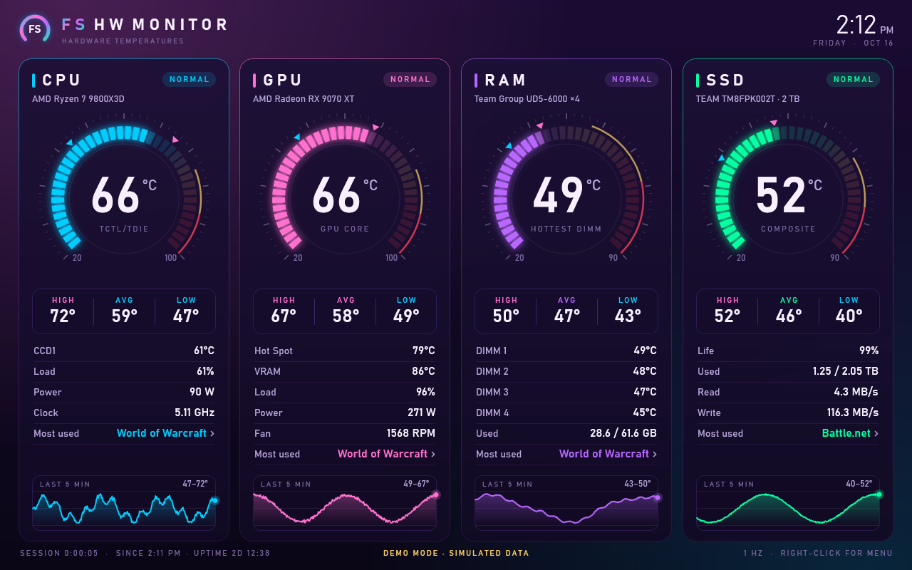 | 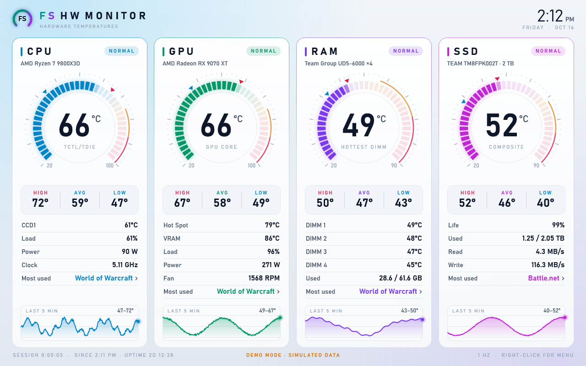 | 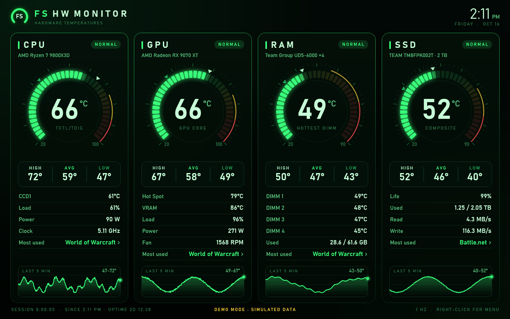 |

### Other layouts

<p>
  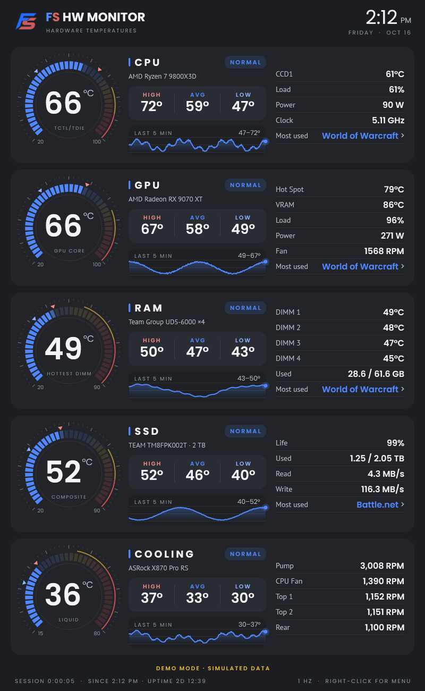
  &nbsp;
  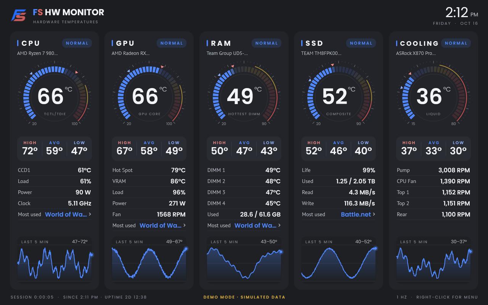
</p>

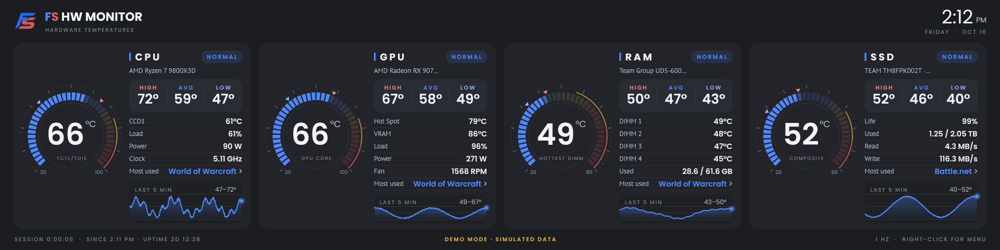

## Requirements

- Windows 10 or 11, x64
- **Administrator rights** for CPU, RAM, SSD and fan sensors. The app asks through UAC when it starts. If you say no, it keeps running and shows only the GPU.
- **The [PawnIO](https://pawnio.eu/) driver** for CPU, RAM and motherboard sensors. It's a one-time install:

  ```powershell
  winget install namazso.PawnIO
  ```

  Or right-click the dashboard and choose **Install sensor driver (PawnIO)**.

### Why install a driver separately?

Reading CPU, memory and fan-controller registers needs kernel access. Older monitoring tools shipped the WinRing0 driver for this, and Windows Defender now blocks it as a vulnerable driver.

FS HW Monitor reads sensors through [LibreHardwareMonitorLib](https://github.com/LibreHardwareMonitor/LibreHardwareMonitor), which uses PawnIO instead. PawnIO is a signed, open-source driver that only runs small, vetted modules. All the sensor code is compiled into the `.exe`; the driver is the one piece Windows has to install system-wide.

## Usage

Run `FSHWMonitor.exe`. If it's already running, it asks whether to bring the running copy to the front or restart it (handy after updating).

- **Right-click** anywhere for the menu: **Settings…**, theme, layout, which cards to show, units, display, always on top, close to tray, night mode, reset stats, sensor report and exit.
- **Hover "Most used"** on a card to see the top five apps for that part.

  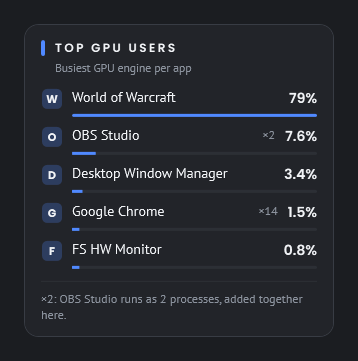

- **Double-click a card** to reset that card's high / avg / low.
- **Click** the dashboard during night mode to light it up for a minute.

### Settings

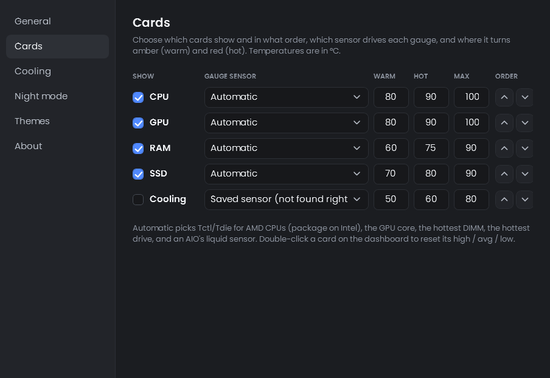

The settings window opens on your main monitor, not the case screen. Changes apply right away and save automatically.

- **General:** theme, layout, display, units, update speed, history length, always on top, close to tray, start with Windows
- **Cards:** show/hide and order, which sensor drives each gauge, and the warm / hot / max points
- **Cooling:** the gauge temperature, names for your fan headers, and which fans to show. Motherboards don't say which header is which; stopping a fan for a moment shows you.
- **Night mode:** schedule, dim or black, brightness, and lighting back up when something runs hot
- **Themes:** save the current theme as a file, open the themes folder, reload

Everything is stored in `%APPDATA%\FS HW Monitor\settings.json`, with `log.txt` next to it.

### Custom themes

Put a `.json` file in `%APPDATA%\FS HW Monitor\themes`. It starts from a built-in theme and only needs the colors you change. Colors are `#RRGGBB`, or `#AARRGGBB` with transparency.

The folder starts with **`OceanTemplate.json`**, which lists every setting with a comment saying what it does. Copy it, rename the copy, change its `Name`, and edit away. Its source is `src/FSHWMonitor/Assets/OceanTemplate.json`.

```json
{
  "Name": "Sunset",
  "Base": "Neon",
  "Cpu": "#FB923C",
  "Gpu": "#F472B6",
  "BackdropTop": "#1A0F14"
}
```

The easiest start is **Settings > Themes > Save current theme as a file**, which writes every color with its name. Edit the file, then click **Reload themes**. If a file has a mistake, it's skipped and the reason goes in `log.txt`.

### USB coolers and fan hubs

Motherboard fan headers are always read. Reading USB AIO coolers and fan hubs (Corsair, NZXT, Aquacomputer and others) is off by default, because polling them alongside iCUE, NZXT CAM or Synapse can upset either app. Turn it on in **Settings > Cooling**.

### Command-line options

| Option | What it does |
| --- | --- |
| `--demo` | Simulated data. No admin rights or driver needed, so it's good for trying the UI. It can run alongside the real dashboard. |
| `--windowed` | Opens as a normal window instead of taking over the in-case display. |
| `--display DISPLAY2` | Covers a specific display, overriding auto-detection and settings. |
| `--theme Frost` | Uses a theme for this run (built-in or custom). Quote names with spaces: `--theme "Full Send"`. |
| `--layout portrait` | Uses a layout for this run: `auto`, `landscape`, `portrait`, `bar`, `tallbar` or `grid`. |
| `--cards cpu,gpu,cooling` | Shows these cards in this order for this run. |
| `--close-to-tray` | Closing hides to the tray for this run, whatever the setting says. |
| `--no-elevate` | Doesn't ask for admin rights; runs in limited mode. |
| `--software-render` | Renders on the CPU. Uses less RAM but more CPU; handy if a graphics driver misbehaves. |
| `--dump sensors.txt` | Writes every detected sensor and the current most-used apps to a text file, then exits. Useful for bug reports. |
| `--snapshot shot.png` | Saves the dashboard as a PNG, then exits. Add `--snapshot-delay 10` to wait longer first. Add `--snapshot-settings Cards` to capture a settings tab instead, or `--snapshot-usage gpu` to capture a Most used popup. |

## Building from source

```powershell
winget install Microsoft.DotNet.SDK.10
.\build.ps1
```

The build writes `dist\FSHWMonitor.exe`, a self-contained file of about 130 MB that zips to about 55 MB. The `.exe` isn't compressed on purpose: in-exe compression would cost about 80 MB of RAM for the whole time the app runs.

### Installer

```powershell
winget install JRSoftware.InnoSetup
.\build.ps1 -Package
```

This also writes the following to `dist`:

- **`FS-HW-Monitor-Setup-<version>.exe`** (about 42 MB). It installs to Program Files, adds Start menu and optional desktop shortcuts, offers to install the PawnIO driver, and registers an uninstaller.
- **A `FS HW Monitor <version>` folder and zip**, holding just the installer and a short `Read me.txt` for sharing.

The installer script is `installer\FSHWMonitor.iss`.

To regenerate the icon, run `tools\make-icon.ps1` in Windows PowerShell.

### Project layout

```
src/FSHWMonitor/
  Sensors/      LibreHardwareMonitor wrapper that picks the best sensor per card, plus the demo data source
  ViewModels/   card state, unit conversion, high/avg/low tracking, polling loop, settings
  Views/        settings window and the already-running prompt
  Controls/     ArcGauge (segmented ring) and Sparkline (history graph), drawn directly with WPF
  Theme/        built-in themes (AppTheme.cs), custom theme loading, and the code that applies them
  Platform/     display detection and layouts, per-app usage sampling, UAC relaunch, single instance, tray icon, startup task, PawnIO check
  Core/         settings, command-line options, stats and ring buffer
  Styles/       dark styling for the settings window and prompts
```

## Performance

These figures are for one sample per second on a Ryzen 7 9800X3D with an RX 9070 XT:

- **CPU:** under 1% of total CPU time
- **RAM:** about 240 MB with GPU rendering. Most of that is the graphics driver's own D3D components, which load into any GPU-accelerated window.
- **With `--software-render`:** about 95 MB of RAM, at about three times the CPU use

## Credits

- [LibreHardwareMonitor](https://github.com/LibreHardwareMonitor/LibreHardwareMonitor) for hardware access (MPL-2.0)
- [PawnIO](https://github.com/namazso/PawnIO) by namazso, the kernel driver
- [Poppins](https://github.com/itfoundry/Poppins) and [PT Sans](https://www.paratype.com/fonts/pt/pt-sans) fonts, bundled under the SIL Open Font License (see `src/FSHWMonitor/Assets/Fonts`)

## License

[MIT](LICENSE)
